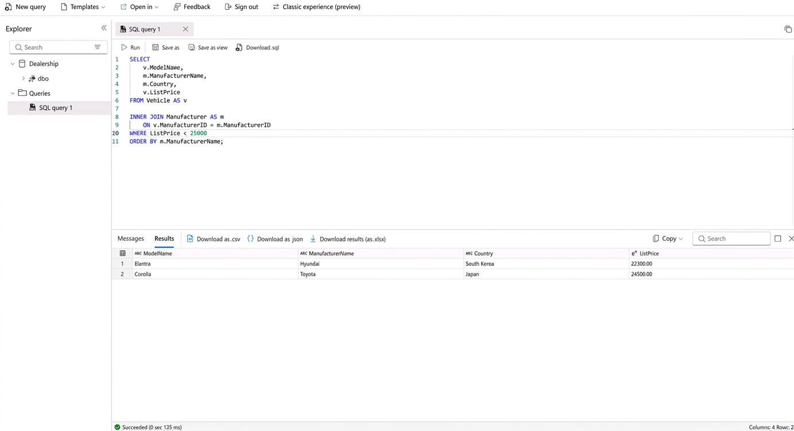
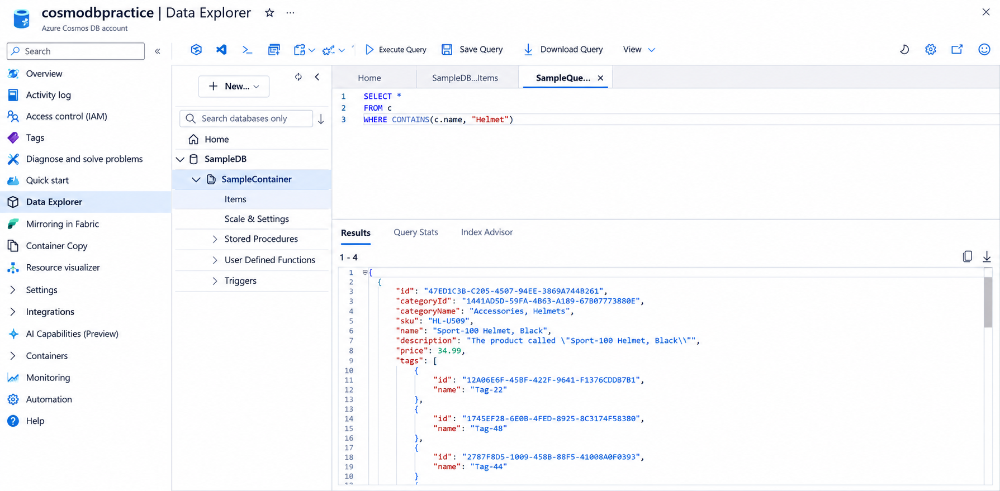
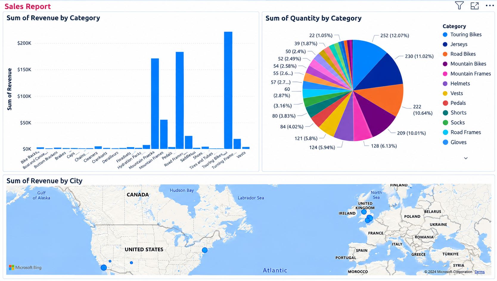

# azure-cloud-data-fundamentals-dp900
Cloud Computing &amp; Azure Data Fundamentals (DP-900) project featuring Azure SQL, Cosmos DB, Microsoft Fabric, and Power BI.
# ☁️ Enterprise Cloud Computing & Azure Data Fundamentals (DP-900)

<p align="center">
  
  
  
  
  
</p>

<p align="left">
  
  &nbsp;&nbsp;
  
  &nbsp;&nbsp;
  
  &nbsp;&nbsp;
  
</p>

<p align="left">
  
</p>

<p align="left">
  
</p>

<p align="left">
  
</p>

---

## 📌 Executive Summary

This repository documents my comprehensive hands-on work and architectural studies completed during the **Microsoft Azure Data Fundamentals (DP-900)** and Cloud Computing module. 

The project covers foundational cloud paradigms, database provisioning, storage optimization, and modern analytics workflows utilizing **Microsoft Fabric** and **Power BI**. Additionally, it includes a complete enterprise case study demonstrating data governance and compliance under UK regulations.

---

## 🏗️ 1. Core Cloud Computing Concepts & Architecture

### Cloud Economics & Service Models
* **IaaS (Infrastructure as a Service):** Provides virtualized computing resources (servers, networking, storage) where the user manages the OS and runtime. *Real-world use case:* Migrating on-premise virtual machines to Azure VMs.
* **PaaS (Platform as a Service):** A managed environment allowing developers and data specialists to focus on application logic and data queries without handling underlying OS patches. *Real-world use case:* **Azure SQL Database**.
* **SaaS (Software as a Service):** Fully managed, end-user applications delivered over the web (e.g., Microsoft 365, Power BI Service).

### Cloud Deployment Models
* **Public Cloud:** Multi-tenant infrastructure hosted by third-party providers (Microsoft Azure, AWS), offering rapid scalability and CAPEX-to-OPEX financial shifts.
* **Private Cloud:** Dedicated infrastructure optimized for strict internal security, compliance, and governance.
* **Hybrid & Community Clouds:** Bridging legacy on-premise workloads with cloud agility while sharing resources across entities with common regulatory needs.

---

## 🗄️ 2. Azure Data Services & Storage Ecosystem

| Azure Service | Data Type | Core Function & Enterprise Purpose |
| :--- | :--- | :--- |
| **Azure SQL Database** | Structured (Relational) | Fully managed relational database engine supporting automated tuning, high availability, and standard T-SQL querying. |
| **Azure Blob Storage** | Unstructured | Cost-effective object storage optimized for massive binary data loads, logs, audio, video, and backup retention. |
| **Azure Cosmos DB** | NoSQL (Semi-structured) | Globally distributed, multi-model database designed for low-latency JSON data access and high-throughput APIs. |
| **Azure Data Factory (ADF)**| Integration / ETL | Cloud-scale data integration service used to orchestrate automated ETL/ELT pipelines from disparate sources. |
| **Microsoft Fabric** | Analytics Workload | Unified analytics platform combining data engineering, warehousing, and real-time intelligence into a single environment. |

---

## 💻 3. Practical SQL & Data Analytics Implementation

### Relational Querying (Azure SQL Database)
Executed multi-table queries utilizing inner joins, filtering, and sorting to extract actionable insights from structured vehicle dealership datasets:

```sql
-- Filtering and joining vehicle records with manufacturer data
SELECT 
    v.ModelName,
    m.ManufacturerName,
    m.Country,
    v.ListPrice
FROM Vehicle AS v
INNER JOIN Manufacturer AS m ON v.ManufacturerID = m.ManufacturerID
WHERE v.ListPrice < 25000
ORDER BY m.ManufacturerName;
```

### Analytical Aggregations
Processed large-scale datasets using temporal extraction and aggregation functions:

-- Calculating average trip distances by day of the week
```sql
SELECT 
    DATENAME(dw, lpepPickupDatetime) AS Day,
    AVG(tripDistance) AS AvgDistance
FROM taxi_rides
GROUP BY DATENAME(dw, lpepPickupDatetime);
```
---

## 💼 4. Enterprise Architecture Case Study: "Paws & Whiskers"
As part of the coursework, I designed a cloud migration proposal for a growing retail business shifting from manual paperwork to an automated cloud infrastructure.

```text
[ POS / Retail Terminals ] 
           │
           ▼
  ( Azure Data Factory ) ──► Automated Pipeline Ingestion
           │
           ├──► [ Azure SQL Database ] ──► Structured Transactions & Inventory
           └──► [ Azure Blob Storage ]  ──► Unstructured Logs & Product Assets
                   │
                   ▼
          ( Power BI Dashboards ) ──► Real-Time Executive Reporting
```

* **Data Governance & Compliance:** Strict adherence to **UK GDPR** and the **Data Protection Act (DPA) 2018**, implementing data minimization, explicit marketing consent, and secure RBAC access controls.

* **Storage Optimization:** Leveraging **CSV** for legacy system data imports, **JSON** for nested customer profiles, and compressed **Parquet** files for high-speed analytical workloads.

* **Disaster Recovery:** Automated snapshot backups and scheduled disaster recovery policies using Azure Backup services.

---

## 🖼️ 5. Practical Lab Evidence & Screenshots

### Azure SQL Database Querying (Lab 1)
Querying relational data in Azure SQL Database using Query Editor with INNER JOIN, WHERE, and ORDER BY clauses.



---

### Non-Relational Storage & Cosmos DB (Lab 2)
Configuring Azure File Shares in Storage Accounts and querying JSON document collections using Cosmos DB Data Explorer.



---

### Microsoft Fabric & Real-Time Analytics (Lab 3)
Setting up lakehouses, running KQL queries in eventstreams, and building interactive Power BI analytics reports.



---

## 📂 Repository Structure

```text
├── README.md                                # Comprehensive project documentation
├── Data_Technician_Workbook_Week_5.docx     # Completed DP-900 Practical Workbook
├── /scripts                                 # Reusable database and analytics queries
│   ├── azure_sql_queries.sql
│   └── fabric_kql_queries.kql
└── /screenshots                             # Verified lab execution evidence
    ├── azure_sql_lab.png
    ├── cosmos_db_lab.png
    └── fabric_powerbi_lab.png
```
---

## 👤 Author

Tymofii Moshkovskyi

Aspiring Data Technician & Junior Data Analyst

St Helens, Merseyside, United Kingdom

Core Expertise: SQL, Microsoft Azure Data Services, Power BI, Data Administration & Processing

---
